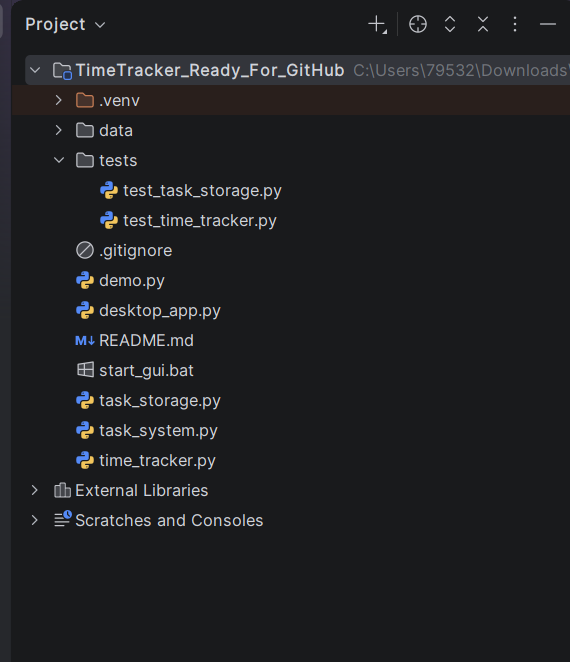
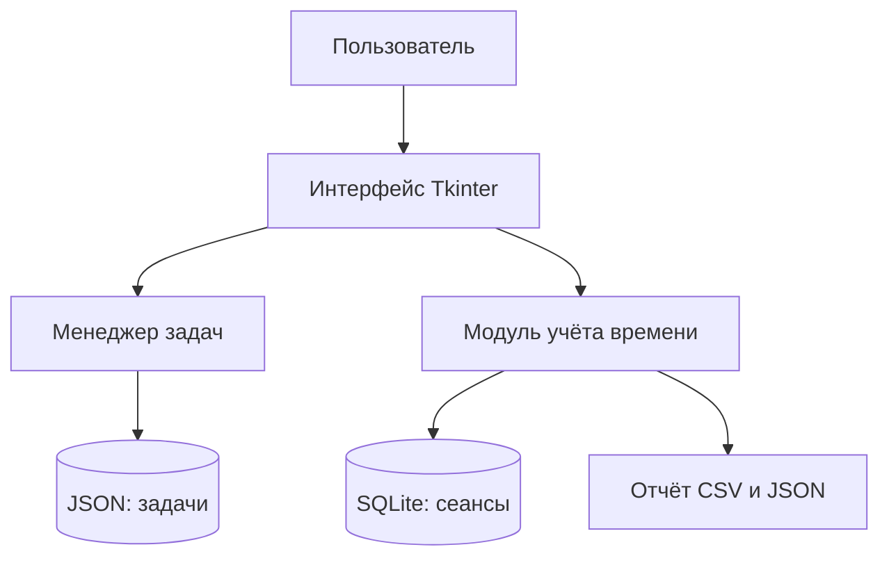
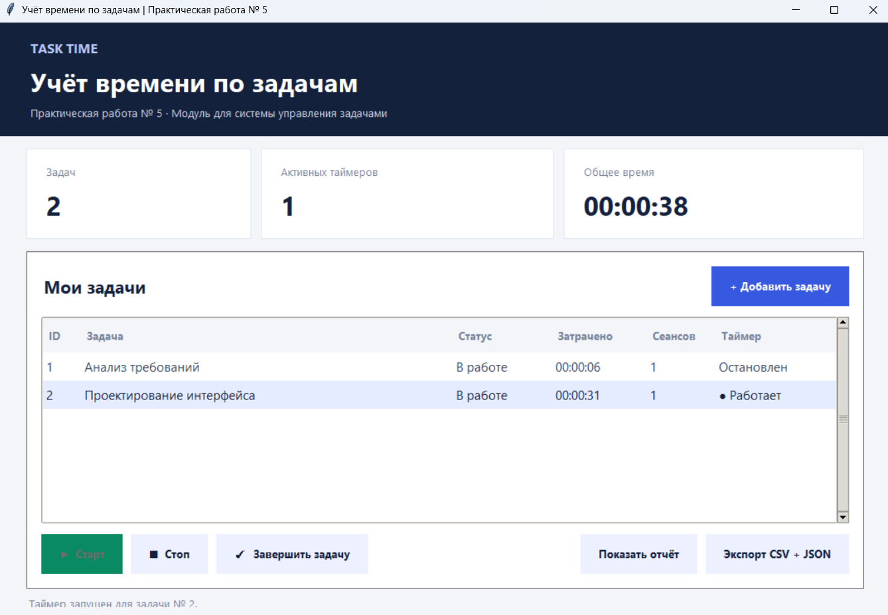
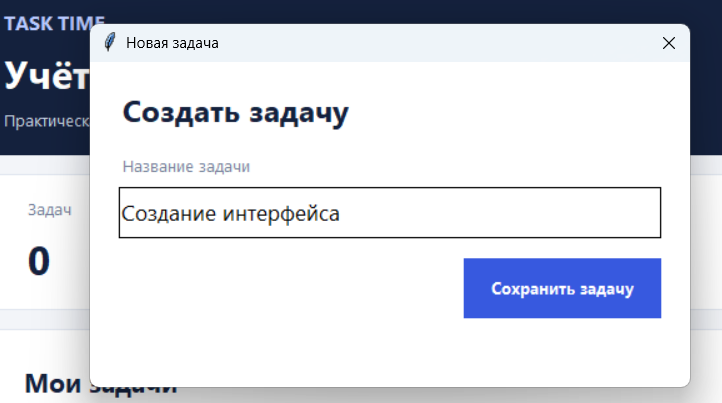
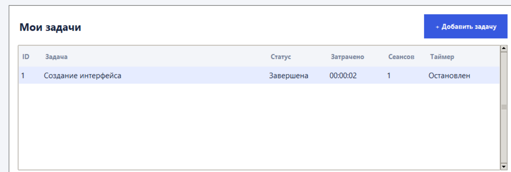
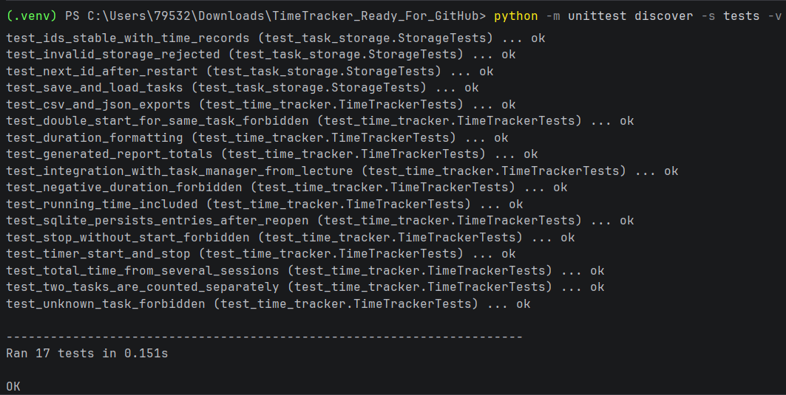
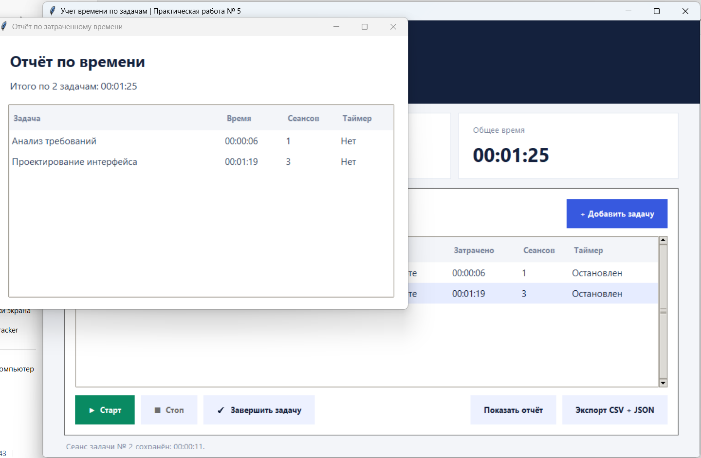
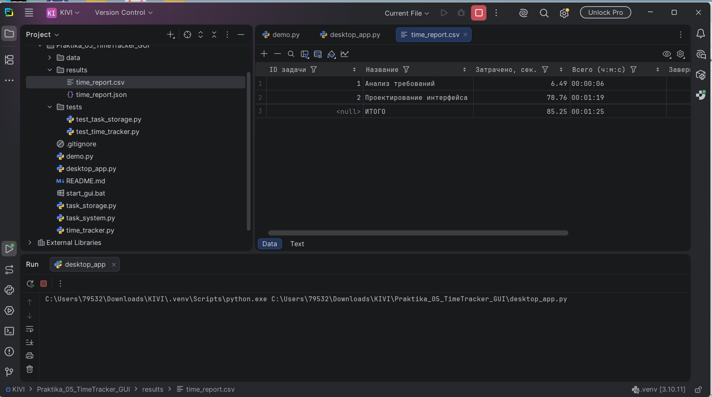

# Отчёт о реализации модуля учёта времени

**Дисциплина:** разработка программного продукта, практическое задание к лекции № 5 «Этапы разработки программного продукта»  
**Тема:** разработка модуля учёта времени для системы управления задачами  
**Среда разработки:** Python 3.10+, PyCharm  
**Результат:** локальное оконное приложение для учёта времени по задачам

> В отчёте описаны реализованные функции и проведённые проверки. Демонстрационные значения времени являются тестовыми, а не реальными трудозатратами. Проект не развёрнут на публичном сервере: его запуск локальный.

## 1. Постановка задачи

Цель: расширить учебную систему управления задачами модулем учёта фактически затраченного времени. В задании преподавателя указаны четыре обязательных требования:

1. Возможность запуска и остановки таймера для задачи.
2. Учёт общего затраченного времени.
3. Генерация отчётов по времени.
4. Интеграция с существующей системой задач.

Критерии оценки: соответствие требованиям – 40 %, качество кода – 30 %, тестовое покрытие – 20 %, документация – 10 %.

Дополнительно реализован графический интерфейс Tkinter, чтобы работу функций можно было показать в отдельном окне без использования консоли.

## 2. Этап 1. Сбор и анализ требований

**Цель этапа:** определить функции будущего модуля и условия их проверки.

| № | Требование | Реализация | Проверка |
|---|---|---|---|
| F1 | Запуск таймера | `TimeTracker.start_timer(task_id)` и кнопка «Старт» | После запуска задача получает активный сеанс |
| F2 | Остановка таймера | `TimeTracker.stop_timer(task_id)` и кнопка «Стоп» | Сеанс закрывается, длительность сохраняется |
| F3 | Общее время | `get_total_time`, `generate_time_report` | Суммирование нескольких сеансов одной задачи |
| F4 | Отчёты | `generate_time_report`, `export_csv`, `export_json` | Просмотр отчёта в окне и экспорт файлов |
| F5 | Интеграция с задачами | `TaskManager` из `task_system.py` | Таймер привязан к ID существующей задачи |

**Дополнительные условия:** повторный запуск активного таймера запрещён; остановка без запуска и запуск для неизвестной задачи вызывают контролируемую ошибку; данные должны сохраняться после перезапуска приложения. Эти условия включены в реализацию и тесты как меры повышения надёжности, а не как отдельные требования исходной методички.

**Результат этапа:** определён перечень функций, критерии проверки и формат локального приложения.

## 3. Этап 2. Проектирование системы

**Архитектура:** функциональность разделена на управление задачами, учёт времени, сохранение данных и интерфейс пользователя.

```text
Пользователь
    |
    v
Окно Tkinter (desktop_app.py)
    |                     |
    v                     v
Задачи (task_system.py)   Таймер и отчёты (time_tracker.py)
    |                     |
    v                     v
Хранение задач           SQLite с историей сеансов
(task_storage.py)         |
    |                     v
    +---- JSON задачи     Экспорт CSV / JSON
```

**Структура проекта в PyCharm**



*Рисунок 1 – Структура программного проекта TimeTracker в PyCharm.*

**Структура данных:** задача имеет идентификатор, название, описание, приоритет, статус и другие свойства учебной системы задач. Сеанс времени связывается с задачей по её ID и содержит момент запуска и момент остановки. Незавершённый сеанс также учитывается при формировании текущего времени.

**Выбранные технологии:** Python 3.10+; Tkinter для оконного интерфейса; SQLite (`sqlite3`) для сеансов учёта времени; JSON для сохранения списка задач; CSV и JSON для выгрузки отчётов; `unittest` для тестирования. Сторонние пакеты не требуются.

Дополнительно взаимодействие компонентов можно представить следующей диаграммой:



**Результат этапа:** создана схема взаимодействия компонентов и определены форматы хранения и обмена данными.

## 4. Этап 3. Реализация (кодирование)

В проекте разработаны следующие части:

| Файл | Содержание |
|---|---|
| `task_system.py` | Учебная модель `Task`, `User`, `TaskManager`, статусы и приоритеты |
| `time_tracker.py` | Начало и окончание сеанса, вычисление времени, SQLite, отчёты, экспорт |
| `task_storage.py` | Сохранение и загрузка задач в JSON |
| `desktop_app.py` | Окно Tkinter: список задач, кнопки, показатели, просмотр отчёта |
| `demo.py` | Проверка расчётов времени в консоли на демонстрационных данных |
| `tests/` | Модульные и интеграционные тесты |

**Главное окно и работающий таймер**



*Рисунок 2 – Главное окно приложения с активным таймером и общим временем по задачам.*

**Создание новой задачи**



*Рисунок 3 – Форма добавления задачи с вводом названия.*

После ввода названия задача сохраняется и отображается в общем списке. Для каждой записи приложение хранит идентификатор, название, состояние выполнения и данные учёта времени.

**Завершение задачи**



*Рисунок 4 – Задача со статусом «Завершена» и сохранённым временем.*

**Сценарий работы пользователя:** открыть приложение → создать задачу → выбрать её → нажать «Старт» → выполнить работу → нажать «Стоп» → посмотреть накопленное время → открыть отчёт → при необходимости экспортировать CSV и JSON. Повторный запуск таймера добавляет новый сеанс к той же задаче, сохраняя предыдущий результат.

**Интерфейс:** приложение показывает список задач, время по каждой задаче, количество сеансов, суммарное время и число работающих таймеров. Также предусмотрена возможность завершить задачу.

**Результат этапа:** создано работающее приложение с отдельным графическим окном и сохранением данных.

## 5. Этап 4. Тестирование

Тесты выполнены стандартным модулем Python `unittest`:

```bash
python -m unittest discover -s tests -v
```

Проверяются, в частности:

- успешный запуск и остановка таймера;
- запрет повторного запуска одного активного таймера;
- запрет остановки без запуска;
- обработка неизвестного ID задачи;
- суммирование времени нескольких сеансов;
- раздельный учёт по разным задачам;
- включение незавершённого сеанса в текущее время;
- формирование общего отчёта и экспорт CSV/JSON;
- сохранение сеансов SQLite после повторного открытия;
- интеграция с менеджером задач;
- сохранение и загрузка списка задач.

**Скриншот результатов автоматического тестирования**



*Рисунок 5 – Результат запуска 17 автоматических тестов с итоговым статусом OK.*

**Результат проверки:** при локальном запуске тестового набора в подготовленной версии проекта пройдено **17 из 17 тестов**, ошибок нет (`OK`). Автоматические тесты проверяют логику и сохранение данных; действия с кнопками в графическом окне дополнительно проверяются вручную.

**Ручная проверка графического интерфейса:** создать задачу → запустить таймер → остановить → повторить запуск → открыть отчёт → экспортировать файлы → закрыть и снова открыть приложение. Для отчёта на GitHub рекомендуется добавить собственные скриншоты по инструкции в `screenshots/`.

## Результаты формирования отчётов

После остановки таймера пользователь может открыть сводку по всем задачам. В ней приводятся суммарное время, количество сеансов и состояние таймера.



*Рисунок 6 – Окно отчёта по затраченному времени.*

Кнопка «Экспорт CSV + JSON» формирует два машинно-читаемых файла. В CSV показаны строки по задачам и итоговый результат; JSON содержит структурированные данные отчёта.



*Рисунок 7 – Открытый в PyCharm отчёт `time_report.csv`.*

## 6. Этап 5. Внедрение и развёртывание

Приложение подготовлено **к локальному запуску на компьютере**, а не к развёртыванию в интернете.

1. Установить Python 3.10 или новее и открыть папку проекта в PyCharm.
2. Выбрать интерпретатор Python.
3. Запустить `desktop_app.py` через `Run` или выполнить:

   ```bash
   python desktop_app.py
   ```

4. Для Windows доступен `start_gui.bat`.
5. Убедиться, что окно открылось, создать задачу и проверить работу таймера и отчёта.

При первом использовании программа автоматически создаёт локальные файлы хранения задач и сеансов. Экспортируемые отчёты формируются в папке `results/`.

**Результат этапа:** проект можно запустить в PyCharm и показать преподавателю. Серверное размещение, публикация установщика и облачная интеграция в задание не входили и не выполнялись.

## 7. Этап 6. Сопровождение и поддержка

Для облегчения сопровождения код разделён на отдельные модули. Проверку изменений можно повторять с помощью `unittest`. Локальные данные остаются в папке `data/`, выгрузки – в `results/`; эти файлы не следует публиковать в общем репозитории, если в них содержатся реальные пользовательские данные.

**Возможные направления развития:** вход по учётным записям, фильтрация отчётов по датам, подключение общей базы задач, многопользовательская синхронизация и сборка исполняемого файла. Это предложения на будущее, а не функции текущей версии.

## 8. Итоговая проверка требований

| Требование преподавателя | Статус |
|---|---|
| Запуск и остановка таймера | Реализовано |
| Учёт общего времени | Реализовано |
| Генерация отчётов | Реализовано |
| Интеграция с системой задач | Реализовано |
| Качество кода | Логика, интерфейс и хранение разделены по модулям |
| Тестирование | 17 автоматических тестов пройдены |
| Документация | `README.md` и этот отчёт |

## 9. Вывод

В результате практической работы создан модуль учёта времени, интегрированный с учебной системой управления задачами. Реализованы запуск и остановка таймера, накопление длительности сеансов, просмотр и экспорт отчётов. Разработано отдельное оконное приложение для демонстрации. Работоспособность основных функций подтверждена автоматическими тестами; для использования достаточно локального запуска Python-проекта.

## 10. Материалы для проверки

- [Основные файлы проекта](#4-этап-3-реализация-кодирование)
- [Главное окно программы](#4-этап-3-реализация-кодирование)
- [`desktop_app.py` – графический интерфейс](desktop_app.py)
- [`time_tracker.py` – модуль учёта времени](time_tracker.py)
- [Тесты](tests/)


## Скриншоты приложения

Все семь иллюстраций размещены в папке [`screenshots`](screenshots/) и включены непосредственно в соответствующие разделы отчёта.

| № | Демонстрируемая функция |
|---|---|
| 1 | Структура Python-проекта |
| 2 | Главное окно с работающим таймером |
| 3 | Создание новой задачи |
| 4 | Завершение задачи |
| 5 | Результаты автоматических тестов |
| 6 | Сводный отчёт по времени |
| 7 | Экспорт данных в CSV |

**Примечание:** время на изображениях получено в ходе демонстрационной проверки функций, а не является учётом реальных трудозатрат.
